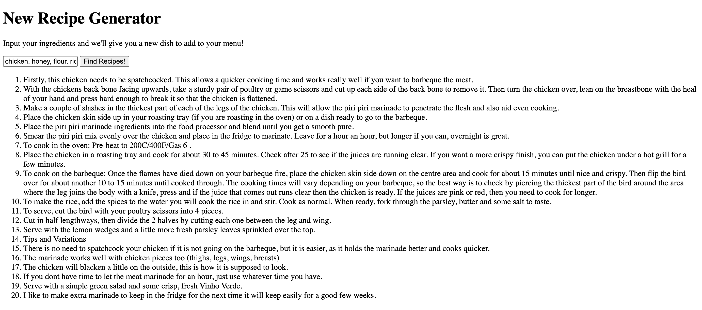

# New Recipe Generator — Simple API Restaurant

A front-end app for someone working in a restaurant kitchen: type in the ingredients you have on hand, and it gives you a random dish you can make with them, complete with step-by-step cooking instructions.



## What it does

- You enter ingredients in a text box, separated by commas — for example, `chicken, rice, garlic`.
- It asks Spoonacular for up to 5 recipes that use those ingredients.
- It picks one of those 5 at random and shows its cooking steps as a numbered list.
- Clicking **Find Recipes!** again clears the old steps and picks a new random dish.

## How it works

This started as a simple API exercise and became a two-call flow, because one API call alone does not give you the instructions:

1. **Find recipes by ingredients**
   `GET https://api.spoonacular.com/recipes/findByIngredients?ingredients={ingredients}&number=5&apiKey={key}`
   Returns up to 5 matching recipes. The app picks one at random and takes its `id` and `title`.
2. **Get the instructions for that recipe**
   `GET https://api.spoonacular.com/recipes/{food_id}/analyzedInstructions?apiKey={key}`
   Returns the analysed steps, which are rendered as `<li>` elements inside the `<ol id="cooking_steps">` on the page.

The ingredient input is normalised before it is sent: commas (with any spaces after them) are replaced with `,+`, which is the format the Spoonacular `ingredients` parameter expects.

## Tech stack

- HTML — `index.html`
- CSS — `css/style.css` (currently only the box-model boilerplate; no app styling yet)
- Vanilla JavaScript, ES modules — `js/main.js`
- Spoonacular API — recipe search + analysed instructions
- No server, no build step, no database, no dependencies

## How to run it

You need a free Spoonacular API key from https://spoonacular.com/food-api.

1. Clone the repo.
2. Create `js/config.js` with your key:
   ```js
   export const spoonacular_api_key = "YOUR_SPOONACULAR_API_KEY_HERE";
   ```
   A `js/config.example.js` with that placeholder is committed as a template — copy it to `js/config.js` and fill in your own key. Never commit the real key.
3. Serve the folder over HTTP — ES module imports do not work from `file://`, so opening `index.html` directly will not load `js/main.js`. Use VS Code Live Server, or from the project root:
   ```
   python3 -m http.server 8000
   ```
   then open http://localhost:8000
4. Type ingredients separated by commas and click **Find Recipes!**

## Project structure

```
index.html          - page: heading, ingredient input, Find Recipes! button, results list
css/style.css       - stylesheet (box-model boilerplate only, for now)
js/main.js          - find_recipes(): formats the input, calls Spoonacular twice,
                      picks a random recipe, renders its steps
js/config.js        - your Spoonacular API key (local only, gitignored — do not commit)
js/config.example.js - placeholder version of config.js, safe to commit
README.md           - this file
```

---

Thay Brown — thaybrown22@gmail.com · https://thaythecoder.netlify.app · https://github.com/tbrown320 · https://www.linkedin.com/in/thaybrown
