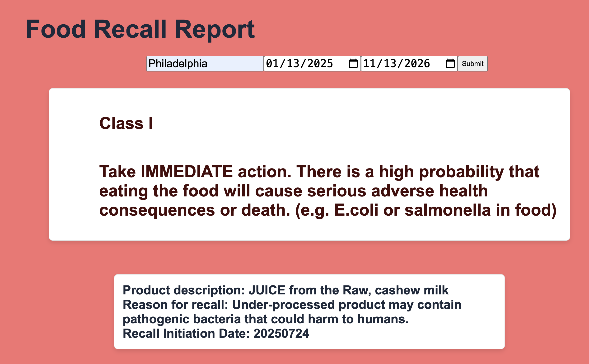

# 🍽️ Food Recall App

An app for checking whether a food product has been recalled, using the FDA's recall data. Built with HTML, CSS, and Vanilla JavaScript.

### Project Description

This project is a food recall lookup app. It gives the user a search bar to enter a product or brand name, queries the FDA's openFDA food enforcement API, and lists:
- matching recall records with the product description
- the reason for the recall
- the recalling firm and
- the classification. 

### Live Link
To access this web application, [click here](https://priscilla-ruilova.github.io/Food-Recall-App-/) or use the link in the About section of this repo. 



### Features

- **Recall results** — input a US city and a date range and the app will display matching recalls with the product description, recalling firm, and reason for recall.
- **Classification** — shows the FDA classification for each recall (Class I, II, or III) so the severity is visible.
- **Empty and error states** — a message is shown when no recalls match the search or when the request fails.
- **Single-page layout** — one `index.html`, no build step, no dependencies to install.

### Tech Used

- **Frontend:** HTML, CSS, JavaScript (vanilla, no framework)
- **API:** [openFDA food enforcement API](https://open.fda.gov/apis/food/enforcement/) — `food/enforcement.json`
- **Browser APIs:** `fetch`, `document.querySelector`, `addEventListener`
- **Hosting:** GitHub Pages

### Things I Learned

- Working with an API:
  - How to build a request URL with template literals so the user's input gets dropped into the query string.
  - Dynamically making CSS styling appear in JS. 
  - How to handle a failed request with `.catch()` so the app doesn't fail silently.
- DOM manipulation:
  - Grabbing elements with `document.querySelector` and write results into the page with `innerText`.
  - Looping over an array of records and create an element for each one with `document.createElement` and `appendChild`.
  - How to clear previous results before rendering a new search so old records don't stack up.
- Debugging:
  - Using `console.log(data)` to inspect the full API response before writing code against it.

### How to Use

1. Clone this repository or the one I forked from above:
```bash
git clone https://github.com/priscilla-ruilova/Food-Recall-App-.git


2. Navigate to the project
```bash
cd Food-Recall-App-
```

3. Open `index.html` in your browser — no install step needed.

4. Make it your own!
- Consider adding a filter for recall classification so users can see only Class I recalls.
- Try adding a date range so users can limit results to recent recalls.
- Try changing the styling in `assets/styles.css` to make it your own.
