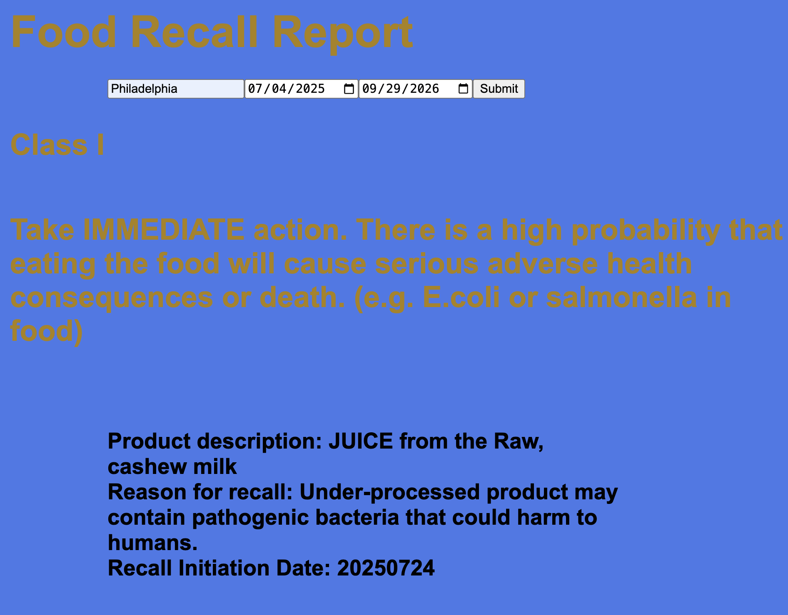

# 🍽️ Project: Simple API 2 - Restaurant

### Goal: Build a simple front-end app that displays data returned from an api that would be beneficial to someone working at or managing a restaurant. 

### Project Description: I used the FDA Food Enforcement API to check any potential food recalls given a date range and city that the user inputs

### Things I learned: 

- This API's documentation can be confusing upon first read. I suggest carfully reading the search parameter documentation.

- The date ranges need to be wildly broad at times when cities did NOT experience many food recalls.

### Tech Stack Used: 
- HTML, CSS, JavaScript

### How to Use: 
- In the search bar, type a city in the US. 
- Give a starting and ending date range to check for food recalls. 
- Note: Some cities have not had a food recall in many months or even over a year. Play around with the starting date range! 
- To visit the site, use the link in the about section of this repo or [CLICK HERE](https://priscilla-ruilova.github.io/Food-Recall-App-/).
