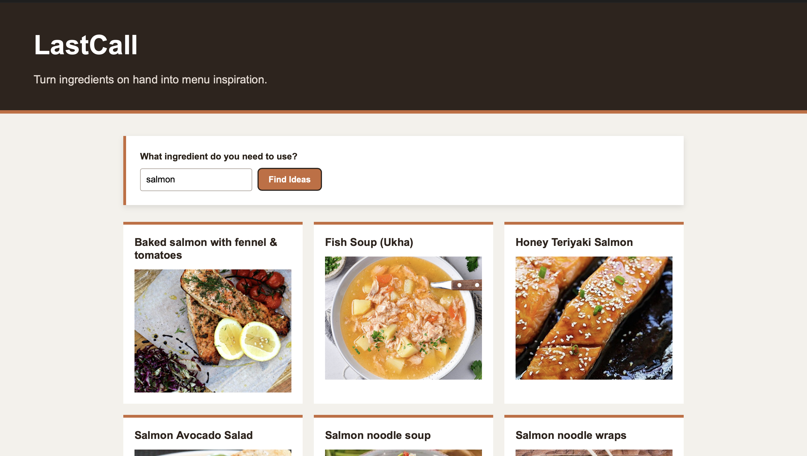

# 🍽️ Project: Simple API 2 - Restaurant

### Goal: Build a simple front-end app that displays data returned from an api that would be beneficial to someone working at or managing a restaurant. 

### How to submit your code for review:

- Fork and clone this repo
- Create a new branch called answer
- Checkout answer branch
- Push to your fork
- Issue a pull request
- Your pull request description should contain the following:
  - (1 to 5 no 3) I completed the challenge
  - (1 to 5 no 3) I feel good about my code
  - Anything specific on which you want feedback!

Example:
```
I completed the challenge: 5
I feel good about my code: 4
I'm not sure if my constructors are setup cleanly...
```

---

## My Solution

**LastCall – Use Everything Up** is a front-end application that helps restaurant staff turn ingredients they already have on hand into meal inspiration.

The application takes an ingredient entered by the user, retrieves relevant meal data through an API, and displays recipe ideas that can help restaurant teams make use of available ingredients before they go to waste.



## How It's Made

**Tech used:** HTML, CSS, JavaScript, APIs

The application accepts an ingredient through the search interface and makes an API request for relevant meal information. JavaScript processes the returned data and dynamically renders recipe results to the DOM, including useful details and visual content for each meal.

## What I Learned

This project gave me additional practice working with APIs, handling asynchronous JavaScript, processing dynamic user input, extracting useful information from returned API data, and rendering results to the DOM.